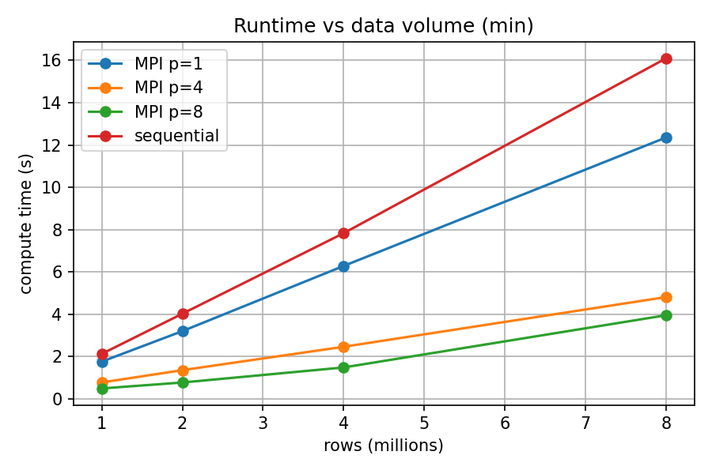
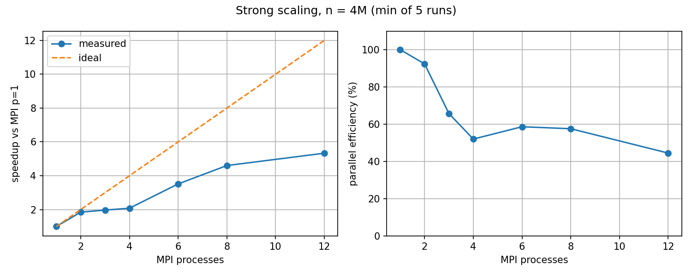
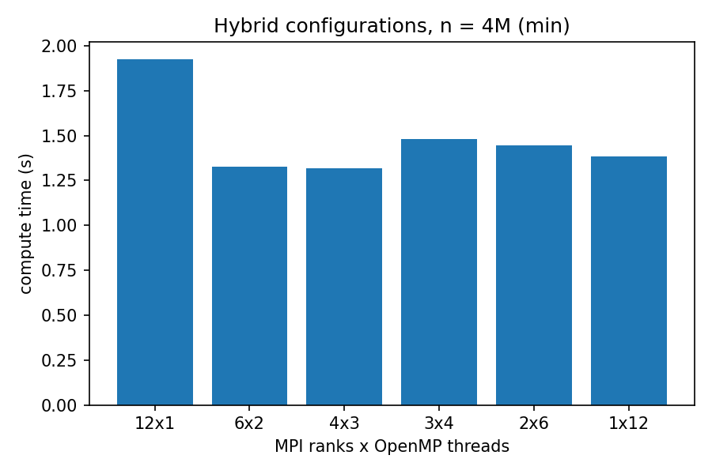

# Anomaly Detection in Network Traffic using Hybrid MPI + OpenMP

**Course project, Parallel Programming (Q33): Anomaly Detection in Network Traffic**


---

## Table of contents

1. [Summary](#1-summary)
2. [Problem statement](#2-problem-statement)
3. [Repository structure](#3-repository-structure)
4. [Dataset](#4-dataset)
5. [Algorithms](#5-algorithms)
6. [Sequential implementation](#6-sequential-implementation)
7. [Parallel implementation (MPI + OpenMP)](#7-parallel-implementation-mpi--openmp)
8. [Correctness verification](#8-correctness-verification)
9. [Experimental setup](#9-experimental-setup)
10. [Results](#10-results)
11. [Analysis and bottlenecks](#11-analysis-and-bottlenecks)
12. [Limitations](#12-limitations)
13. [Build, run and reproduce](#13-build-run-and-reproduce)
14. [Use of LLM / Generative AI](#14-use-of-llm--generative-ai)
15. [Team contributions](#15-team-contributions)
16. [Glossary](#16-glossary)

---

## 1. Summary

| Item | Value |
|---|---|
| Task | Flag unusual flows in a large network-traffic dataset; study how run time changes with data volume |
| Language | C (detectors), Python (data generation, plotting) |
| Detectors | K-means distance detector (sequential and parallel), Z-score detector (sequential baseline) |
| Parallel model | Hybrid **MPI + OpenMP** (no CUDA: the laptop has integrated graphics only) |
| Data | Synthetic flows, 16 features, about 1% injected anomalies, 1M to 8M rows |
| Hardware | Dell Latitude 3440, Intel Core i5-1235U (12 hardware threads), WSL2 Ubuntu, 3.7 GiB RAM |

**Main findings (details in section 10):**

- Run time grows roughly **linearly** with the number of flows, for every configuration.
- At 4M rows, K-means with 12 MPI processes is **5.3x faster than MPI with 1 process** and **6.6x faster than the sequential program** (minimum of 5 runs).
- Parallel efficiency is high at 2 processes (92%) and falls to 44% to 66% at 3 or more processes. The cause was not isolated (section 11).
- The Z-score detector is about 50x cheaper than K-means, so it was left sequential.
- Timings on this laptop drifted by up to about 25% between sessions. Absolute times are therefore only comparable within one experiment.
- Detection results on synthetic data are close to perfect by construction and say little about real attacks.

---

## 2. Problem statement

Network traffic datasets can contain millions of flow records. Anomalies such as DDoS bursts, port scans or data exfiltration are rare and hard to find by hand. The goal is to build a system that identifies unusual patterns in a large flow dataset, and to **investigate how processing time changes as the volume of network data increases**.

The project instructions additionally require a sequential version, a parallel version, a justified choice of parallel model, a correctness check, and a performance evaluation (execution time, speedup, efficiency, effect of thread/process count, effect of input size, bottlenecks).

---

## 3. Repository structure

```
network-anomaly-detection/
├── README.md                  this document
├── scripts/
│   ├── gen_synthetic.py       synthetic data generator
│   ├── build.sh               compiles all C programs into bin/
│   ├── bench.sh               full benchmark driver (writes results/results.csv)
│   └── plot.py                graphs + results/summary.txt
├── src/
│   ├── common/common.h        timer, file loading, precision/recall reporting
│   ├── sequential/
│   │   ├── zscore_seq.c       sequential Z-score detector
│   │   └── kmeans_seq.c       sequential K-means detector
│   └── mpi_openmp/
│       └── kmeans_mpi.c       hybrid MPI + OpenMP K-means detector
├── results/
│   ├── results.csv            raw timings (150 rows)
│   ├── summary.txt            tables derived from results.csv
│   ├── zscore.csv, zscore.log Z-score timings and accuracy
│   ├── strong_scaling.png, data_volume.png, hybrid.png
│   └── bench.log              console log of the benchmark run
├── llm_log/llm_log.md         LLM usage log
├── report/report.md           report draft
└── data/                      generated data (not in git: files are large)
```

---

## 4. Dataset

### 4.1 What it is

The data is **synthetic**, generated by `scripts/gen_synthetic.py`. No external dataset was downloaded. The assignment explicitly allows creating a synthetic dataset.

### 4.2 How it is generated

1. Three random "centres" are drawn in 16 dimensions. They stand in for three kinds of normal traffic.
2. Every normal flow is one of the centres plus Gaussian noise.
3. About 1% of the rows are turned into anomalies: 3 of the 16 features are shifted by 10 to 14 units (random sign).
4. Rows are written as raw `float32` to `data/flows_N.bin`. The true labels (one byte per row) go to `data/flows_N.labels`.
5. A fixed random seed (42) makes the data reproducible.

The 16 columns are generic numbers, not real fields such as packet count or flow duration.

### 4.3 Sizes

| Rows | File size (16 x float32 = 64 B/row) |
|---|---|
| 1,000,000 | 64 MB |
| 2,000,000 | 128 MB |
| 4,000,000 | 256 MB |
| 8,000,000 | 512 MB |

The sizes stop at 8M because WSL2 exposes only 3.7 GiB of RAM and the sequential program holds the whole file in memory.

### 4.4 Limitation of the data

The injected anomalies are far from normal traffic. Both detectors therefore score near-perfectly. The data is good for **validating correctness** (labels are known for every row) and **measuring scaling** (any size can be generated). It is **not** evidence of detection quality on real traffic.

---

## 5. Algorithms

### 5.1 Z-score detector (baseline)

1. One pass computes per-feature mean and standard deviation.
2. A second pass computes, for each flow, the largest |z| over its 16 features.
3. A flow is flagged if that value exceeds **4.5**.

### 5.2 K-means distance detector (main workload)

1. **Initialisation (deterministic):** the k = 8 initial centroids are rows `c * (n / k)` for `c = 0..7`. The sequential and parallel programs use the same rule, so their results can be compared.
2. **Iterations:** a **fixed 20 iterations** (the 1e-4 convergence test is present but not reached on this data within 20 iterations). A fixed count means every run does equal work, which makes timings comparable.
   - Assignment step: each flow goes to its nearest centroid (squared Euclidean distance).
   - Update step: each centroid becomes the mean of its assigned flows. An empty cluster keeps its old centroid.
3. **Scoring:** the anomaly score of a flow is its distance to the nearest centroid.
4. **Threshold:** a flow is flagged if its score exceeds `mean + 4 * standard deviation` of all scores. On the 1M-row file the threshold is 11.248.

Cost per iteration: **O(n * k * d)** with k = 8 and d = 16.

---

## 6. Sequential implementation

| Program | Source | Behaviour |
|---|---|---|
| `zscore_seq` | `src/sequential/zscore_seq.c` | Loads the whole file, two passes, reports precision/recall/F1 and times |
| `kmeans_seq` | `src/sequential/kmeans_seq.c` | Loads the whole file, 20 K-means iterations, scoring, same reporting |

Timing uses `clock_gettime(CLOCK_MONOTONIC)`. The program reports `time_load` (file read) and `time_compute` (all computation). Only **compute time** is used for speedup.

---

## 7. Parallel implementation (MPI + OpenMP)

Source: `src/mpi_openmp/kmeans_mpi.c`.

### 7.1 Why this model

- Flows are **independent**, so the data can be block-partitioned across processes with no communication during the heavy assignment loop.
- The only communication per iteration is a small reduction (8 x 16 doubles of centroid sums plus 8 counts). Communication is cheap relative to computation.
- MPI scales beyond a single machine's memory; OpenMP reduces communication on a multi-core node by sharing memory inside a process.
- **CUDA was not used:** the Latitude 3440 has only integrated graphics.
- **Z-score was not parallelised:** one pass takes about 0.04 s per million rows (section 10.4), too short to scale meaningfully.

### 7.2 Data partitioning

```
base = n / p            rem = n % p
rows_for_rank r = base + (r < rem ? 1 : 0)
first_row_of_r  = r * base + min(r, rem)
```

The first `n % p` ranks receive one extra row, so n does not need to be divisible by p. Each rank reads **only its own block** of the file (`fseeko` + `fread`). No scatter is needed.

### 7.3 Per-iteration flow

```
rank 0 reads the k initial rows  ──MPI_Bcast──►  every rank has identical centroids
repeat 20 times:
    OpenMP parallel region (inside each rank):
        each thread: private sums[k*d] and counts[k]
        each thread: loop over its share of local rows, assign to nearest centroid
        merge thread-private sums into rank sums (critical section)
    MPI_Allreduce(sums, SUM)        every rank gets global sums
    MPI_Allreduce(counts, SUM)      every rank gets global counts
    every rank updates the centroids identically
scoring (OpenMP parallel-for with reduction for score sum and sum of squares)
MPI_Allreduce(score statistics)  →  identical threshold on every rank
count flagged / TP / FP / FN locally, MPI_Reduce to rank 0
```

### 7.4 Key design points (useful for the viva)

| Point | Choice | Reason |
|---|---|---|
| Combining centroid sums | `MPI_Allreduce`, not `MPI_Reduce` | Every rank needs the new centroids for the next iteration |
| Uneven row counts | Formula above, no `MPI_Scatter` | `MPI_Scatter` needs equal chunks; n is not always divisible by p |
| Races inside a rank | Thread-private accumulators, merged in a `critical` section | Avoids data races and false sharing on shared sums |
| Same starting point as sequential | Rank 0 reads rows `c*(n/k)` and `MPI_Bcast`s them | Reproducible, comparable results; avoids per-rank random seeding |
| Reported time | Maximum over ranks (`MPI_Reduce`, `MPI_MAX`) | The slowest rank determines the wall-clock time |
| Convergence check | Computed from the reduced centroids | Identical on all ranks, so all ranks stop together |

### 7.5 Process and thread placement

- **Pure MPI runs** use `--bind-to hwthread --map-by hwthread` (one rank pinned to one hardware thread). This gave the most consistent timings in a placement test (section 10.6).
- **Hybrid runs** (more than one thread per rank) use `--bind-to none`. Pinning a rank to one hardware thread would squeeze all of its OpenMP threads onto that thread.
- `--oversubscribe` was **never** used. All process counts up to 12 map to real hardware threads.

---

## 8. Correctness verification

### 8.1 K-means: parallel against sequential

Same 1M-row file, 8 clusters:

| Run | Iterations | Threshold | Flagged | Precision | Recall |
|---|---|---|---|---|---|
| Sequential | 20 | 11.248 | 10,191 | 1.0000 | 1.0000 |
| MPI p = 1 | 20 | 11.248 | 10,191 | 1.0000 | 1.0000 |
| MPI p = 2 | 20 | 11.248 | 10,191 | 1.0000 | 1.0000 |
| MPI p = 3 | 20 | 11.248 | 10,191 | 1.0000 | 1.0000 |
| MPI p = 4 | 20 | 11.248 | 10,191 | 1.0000 | 1.0000 |
| MPI p = 2, 2 threads each | 20 | 11.248 | 10,191 | 1.0000 | 1.0000 |

- **p = 3 deliberately tests the uneven split**: 1,000,000 is not divisible by 3.
- Floating-point sums are added in a different order in parallel, so tiny last-digit differences in thresholds are possible.
- Correctness was checked on the 1M-row file only. The larger benchmark runs were timed, and their output was not compared against the sequential results.

### 8.2 Detection quality on the synthetic data

| Detector | Rows | Flagged | True positives | False positives | Missed | Precision | Recall |
|---|---|---|---|---|---|---|---|
| K-means | 1M | 10,191 | 10,191 | 0 | 0 | 1.0000 | 1.0000 |
| Z-score | 1M | 10,196 | 10,191 | 5 | 0 | 0.9995 | 1.0000 |
| Z-score | 2M | | 20,236 | 12 | 0 | 0.9994 | 1.0000 |
| Z-score | 4M | | 40,149 | 20 | 0 | 0.9995 | 1.0000 |
| Z-score | 8M | | 80,004 | 39 | 0 | 0.9995 | 1.0000 |

These results reflect how easy the synthetic anomalies are, not real-world performance.

---

## 9. Experimental setup

| Item | Value |
|---|---|
| Machine | Dell Latitude 3440 |
| CPU | Intel Core i5-1235U (2 performance + 8 efficiency cores, 12 hardware threads, 15 W class) |
| OS | Windows with WSL2, Ubuntu |
| RAM visible to WSL | 3.7 GiB (default limit, not raised) |
| MPI | Open MPI 4.1.6 |
| Compile flags | `gcc -O2` (sequential), `mpicc -O2 -fopenmp` (parallel) |
| Timers | `clock_gettime` (sequential), `MPI_Wtime` (parallel) |
| Repeats | 5 runs per configuration (3 for Z-score) |
| Statistic reported | **Minimum** of the repeats (see below) |
| Conditions | Plugged in, nothing else running |

**Why the minimum:** background load, thermal limits and CPU frequency changes can only slow a run down, so the minimum is the least disturbed measurement. Median and maximum are listed alongside for the strong-scaling experiment (section 10.2).

**CPU layout under WSL:** `lscpu -e` reports 6 identical cores with 2 threads each. WSL does not expose the performance/efficiency core split, so ranks could not be pinned to specific core types.

### Experiments

| Experiment | What varies | Fixed | Runs |
|---|---|---|---|
| Strong scaling | MPI processes p = 1, 2, 3, 4, 6, 8, 12 (1 thread each) | n = 4M | 8 configs x 5 |
| Data volume | n = 1M, 2M, 4M, 8M; sequential, p = 1, 4, 8 | | 16 configs x 5 |
| Hybrid | ranks x threads = 12x1, 6x2, 4x3, 3x4, 2x6, 1x12 | n = 4M, 12 hardware threads | 6 configs x 5 |
| Z-score | n = 1M to 8M | sequential | 4 x 3 |

Total benchmark: 150 timing rows in `results/results.csv`.

---

## 10. Results

All times are **compute time in seconds** (minimum of 5 runs unless stated).

### 10.1 Run time vs data volume



| Rows | Sequential | MPI p = 1 | MPI p = 4 | MPI p = 8 |
|---|---|---|---|---|
| 1M | 2.130 | 1.764 | 0.779 | 0.495 |
| 2M | 4.027 | 3.204 | 1.359 | 0.776 |
| 4M | 7.831 | 6.283 | 2.464 | 1.487 |
| 8M | 16.093 | 12.352 | 4.812 | 3.953 |

Factor by which time grows when the rows double:

| Step | Sequential | p = 1 | p = 4 | p = 8 |
|---|---|---|---|---|
| 1M to 2M | 1.89 | 1.82 | 1.74 | 1.57 |
| 2M to 4M | 1.94 | 1.96 | 1.81 | 1.92 |
| 4M to 8M | 2.06 | 1.97 | 1.95 | **2.66** |

**Reading:** time is roughly linear in n, as expected from O(n * k * d * iterations). One point stands out: p = 8 at 8M rows grew 2.66x. It was **not investigated**, and no per-run spread is available for the data-volume runs, so it may be noise or a real effect.

### 10.2 Strong scaling (n = 4M)



Baseline for speedup: **MPI p = 1** (8.345 s). Efficiency = speedup / p.

| p | Min (s) | Median (s) | Max (s) | Speedup vs p = 1 | Efficiency | Speedup vs sequential (10.328 s) |
|---|---|---|---|---|---|---|
| 1 | 8.345 | 8.727 | 8.912 | 1.00 | 100% | 1.24 |
| 2 | 4.518 | 4.964 | 5.047 | 1.85 | 92% | 2.29 |
| 3 | 4.236 | 5.731 | 13.649 | 1.97 | 66% | 2.44 |
| 4 | 4.015 | 4.459 | 4.690 | 2.08 | 52% | 2.57 |
| 6 | 2.374 | 2.665 | 3.257 | 3.52 | 59% | 4.35 |
| 8 | 1.814 | 2.000 | 2.250 | 4.60 | 58% | 5.69 |
| 12 | 1.565 | 1.771 | 2.088 | 5.33 | 44% | 6.60 |

Sequential program at 4M rows: min 10.328 s, median 10.438 s, max 12.775 s.

**Karp-Flatt metric** (estimates the fraction of run time that does not speed up; a constant value would indicate a fixed serial fraction):

| p | 2 | 3 | 4 | 6 | 8 | 12 |
|---|---|---|---|---|---|---|
| e | 0.08 | 0.26 | 0.31 | 0.14 | 0.11 | 0.11 |

**Reading:**

- Scaling is good up to 2 processes (92% efficient).
- The metric jumps at p = 3 and 4, then settles near 0.11 for p = 6 to 12. A single Amdahl serial fraction does not explain this shape, so the cause of the weak p = 3 and p = 4 points is unknown.
- The p = 3 maximum (13.649 s) is a clear outlier. Its minimum (4.236 s) is plausible, and its median is distorted. This is one reason the minimum is reported.

### 10.3 Hybrid MPI x OpenMP (n = 4M, 12 hardware threads in total)



| Ranks x threads | Min compute (s) | Placement |
|---|---|---|
| 12 x 1 | 1.926 | pinned |
| 6 x 2 | 1.329 | unbound |
| 4 x 3 | 1.317 | unbound |
| 3 x 4 | 1.483 | unbound |
| 2 x 6 | 1.444 | unbound |
| 1 x 12 | 1.386 | unbound |

**This comparison is confounded.** The 12 x 1 run was pinned while all the others were unbound, so the 1.926 s vs about 1.3 to 1.5 s gap could come from the pinning or from the thread mix, and the data cannot separate them. Differences among the unbound splits (1.32 to 1.48 s) are within the observed drift (see 10.5). **No ranking of hybrid configurations is claimed.**

### 10.4 Z-score baseline

| Rows | Min compute (s) | Sequential K-means, same size (s) | Ratio |
|---|---|---|---|
| 1M | 0.038 | 2.130 | about 56x |
| 2M | 0.079 | 4.027 | about 51x |
| 4M | 0.151 | 7.831 | about 52x |
| 8M | 0.347 | 16.093 | about 46x |

Z-score is also linear in n (each doubling multiplies the time by 1.9 to 2.3). The ratios are approximate because the K-means and Z-score numbers come from different sessions.

### 10.5 Run-to-run drift

The same configuration measured in different sessions:

| Configuration | Session A | Session B | Difference |
|---|---|---|---|
| MPI p = 1, 4M rows | 8.345 s (strong scaling) | 6.283 s (data volume) | A is 33% slower |
| Sequential, 4M rows | 10.328 s (strong scaling) | 7.831 s (data volume) | A is 32% slower |
| MPI p = 12 (pinned), 4M rows | 1.565 s (strong scaling) | 1.926 s (hybrid 12 x 1) | B is 23% slower |

Machine speed changed by roughly 25% to 30% between sessions. The cause was **not identified** (thermal limits, background load and CPU frequency are candidates). Consequence: compare absolute times only within a single experiment, and treat all speedups as carrying about that uncertainty.

### 10.6 Process-placement test (1M rows, p = 4)

| Setting | Compute times (s) |
|---|---|
| default | 0.82, 0.88, 1.68 |
| `--bind-to none` | 1.80, 1.09, 0.95 |
| `--bind-to hwthread --map-by hwthread` | 0.93, 0.92, 0.84 |

The pinned setting was the most consistent and was used for pure-MPI runs. An earlier single p = 4 measurement of 1.51 s, which looked like a scaling anomaly, did not reproduce.

---

## 11. Analysis and bottlenecks

The statements below are separated into what the data shows and what is only a hypothesis. **No hypothesis was confirmed by an isolating experiment.**

### What the data shows

1. Run time is approximately linear in the number of flows for the sequential, p = 1, p = 4 and Z-score runs.
2. K-means at 4M rows gets 5.3x faster with 12 processes against MPI p = 1, and 6.6x against the sequential program.
3. Parallel efficiency is 92% at p = 2 and 44% to 66% from p = 3 upward.
4. The sequential K-means is consistently **21% to 30% slower than MPI with 1 process**, at every data size and in both experiments. This reproduces across sessions, so it is not noise. The cause is unknown. A difference in compiler optimisation between the plain build and the `-fopenmp` build is one possibility, and was not tested. Speedups are therefore reported against MPI p = 1, with the sequential time alongside.

### Hypotheses (not tested)

| Candidate | Why it is plausible | What would test it |
|---|---|---|
| Mixed performance / efficiency cores | The i5-1235U has 2 fast and 8 slow cores, so ranks on slow cores set the pace | Run on a CPU with uniform cores; pin to known core types (not possible under WSL) |
| Memory bandwidth | K-means over millions of rows is bandwidth-bound; all cores share one memory system | Measure achieved bandwidth; vary data size relative to cache |
| WSL hides the real core layout | `lscpu -e` shows 6 identical cores | Run on native Linux |
| Thermal throttling / background load | 15 W chip, 25% to 33% drift between sessions | Log CPU frequency and temperature during runs |
| Communication cost | Each iteration reduces 8 x 16 doubles plus 8 counts | Time the `MPI_Allreduce` calls separately (not done) |

Communication volume is small, so it is unlikely to be the main cost, but this was not measured. On a single machine, MPI messages travel through shared memory and not a network, so the results say nothing about cluster communication cost.

---

## 12. Limitations

- **Synthetic data only.** Anomalies are easy to separate; detection accuracy does not transfer to real traffic. Real datasets (for example CIC-IDS2017, UNSW-NB15) were not used.
- **Z-score is sequential only.**
- **Single laptop.** No network communication cost is measured, and the hardware is thermally limited.
- **Timing noise.** Up to about 25% to 33% drift between sessions. The strong-scaling experiment was run non-interleaved (all repeats of one configuration back to back), so drift may bias individual points.
- **Hybrid experiment is confounded** by different pinning (section 10.3).
- **Correctness was checked on 1M rows only.**
- **Memory-limited sizes.** Data stops at 8M rows (512 MB) because WSL exposes 3.7 GiB.
- **Unexplained gap** between sequential and MPI p = 1.
- **No weak-scaling experiment.**

### Possible future work

- Interleaved repeat of the strong-scaling runs (all process counts within each repeat) so drift affects all configurations equally, plus an unpinned p = 12 run to settle the hybrid confound.
- Real labelled dataset for detection quality.
- Time the `MPI_Allreduce` calls and the OpenMP merge separately.
- Parallel I/O (MPI-IO) and a parallel Z-score.
- Compare sequential and parallel builds with identical compiler flags.

---

## 13. Build, run and reproduce
cd /workspaces/network-anomaly-detection
set -o pipefail
mkdir -p results/logs

echo "========== MPI K-MEANS =========="
OMP_NUM_THREADS=1 mpirun --oversubscribe -np 4 --use-hwthread-cpus \
  ./bin/kmeans_mpi data/flows_1000000.bin 1000000 16 data/flows_1000000.labels 8 \
  2>&1 | tee results/logs/kmeans_mpi.log
status=${PIPESTATUS[0]}
if [ "$status" -ne 0 ]; then
  echo "MPI K-means failed with exit code $status"
  exit "$status"
fi

echo "========== HYBRID MPI + OPENMP =========="
OMP_NUM_THREADS=3 mpirun --oversubscribe -np 2 --use-hwthread-cpus --bind-to none \
  ./bin/kmeans_mpi data/flows_1000000.bin 1000000 16 data/flows_1000000.labels 8 \
  2>&1 | tee results/logs/kmeans_hybrid.log
status=${PIPESTATUS[0]}
if [ "$status" -ne 0 ]; then
  echo "Hybrid experiment failed with exit code $status"
  exit "$status"
fi

echo "========== EXPERIMENT LOGS =========="
ls -lh results/logs/
echo "========== PARALLEL EXPERIMENTS COMPLETED =========="


### Requirements (Ubuntu / WSL2)

```bash
sudo apt install -y build-essential openmpi-bin libopenmpi-dev \
    python3 python3-numpy python3-pandas python3-matplotlib
```

### Build

```bash
bash scripts/build.sh          # creates bin/zscore_seq, bin/kmeans_seq, bin/kmeans_mpi
```

### Generate data

```bash
python3 scripts/gen_synthetic.py 1000000     # writes data/flows_1000000.bin and .labels
```

### Run one experiment

```bash
# sequential
./bin/zscore_seq data/flows_1000000.bin 1000000 16 data/flows_1000000.labels
./bin/kmeans_seq data/flows_1000000.bin 1000000 16 data/flows_1000000.labels 8

# parallel: 4 ranks, 1 thread each
OMP_NUM_THREADS=1 mpirun -np 4 --use-hwthread-cpus \
    ./bin/kmeans_mpi data/flows_1000000.bin 1000000 16 data/flows_1000000.labels 8

# hybrid: 2 ranks x 3 threads
OMP_NUM_THREADS=3 mpirun -np 2 --use-hwthread-cpus --bind-to none \
    ./bin/kmeans_mpi data/flows_1000000.bin 1000000 16 data/flows_1000000.labels 8
```

Arguments of `kmeans_mpi`: `data  n  d  labels|-  k  [mult=4.0]  [maxit=20]`. Threads per rank come from `OMP_NUM_THREADS`.

### Reproduce all results

```bash
for n in 1000000 2000000 4000000 8000000; do python3 scripts/gen_synthetic.py $n; done
MPIFLAGS="--use-hwthread-cpus --bind-to hwthread --map-by hwthread" REPS=5 bash scripts/bench.sh
STAT=min python3 scripts/plot.py
```

The benchmark takes roughly 15 to 20 minutes with nothing else running. Keep the laptop plugged in. Expected output: `done: results/results.csv (150 rows)`.

Data files are not stored in the repository (the largest is 512 MB, and GitHub rejects files over 100 MB).

---

## 14. Use of LLM / Generative AI

**Tool used:** Claude (Anthropic), via claude.ai. The full prompt log is in [`llm_log/llm_log.md`](llm_log/llm_log.md).

### What the LLM was used for

Project planning, hardware-specific adjustments, the sequential and hybrid C code, the data generator, the benchmark and plotting scripts, debugging environment and git problems, and drafting this document.

### How the output was verified

- Sequential code run on 1M rows: K-means precision and recall 1.0; Z-score recall 1.0.
- Parallel code compared against sequential at p = 1, 2, 3, 4 and 2 ranks x 2 threads (section 8).
- Benchmark script sanity-checked (missing data files were caught before running), row count checked by hand (30 configurations x 5 repeats = 150).
- Numbers in this document were taken from `results/summary.txt`, `results/zscore.csv` and the console outputs, and derived values (speedups, efficiencies, growth factors, Karp-Flatt) were recomputed from them.

### Critical evaluation: where LLM output was wrong, rejected or modified

| # | LLM suggestion | Problem | Resolution | Verification |
|---|---|---|---|---|
| 1 | Raise the WSL memory limit to 5 GB | Extra setup effort for a college project | **Rejected.** Data was capped at 8M rows (512 MB) | The 8M runs completed within the 3.7 GiB limit. `[CONFIRM: state here whether swap use was checked with free -h; delete this sentence if it was not]` |
| 2 | Hypothesis: a slow p = 4 run (1.51 s, slower than p = 3) came from CPU placement | Repeated runs gave about 0.82 to 0.92 s with one outlier, so the first run was noise | **Hypothesis dropped** | 3 runs under each of 3 placement settings (section 10.6) |
| 3 | One set of MPI flags (pinned, `--bind-to hwthread`) for every benchmark run | Would force all OpenMP threads of a rank onto one hardware thread in hybrid runs | **Modified:** hybrid runs use `--bind-to none` | Reviewed before the benchmark was run; the resulting pinned/unbound difference is disclosed as a confound in section 10.3 |
| 4 | Expected about 235 result rows | Miscounted | **Corrected** to 150 (30 x 5) | Hand count; `bench.sh` prints the real number at the end |
| 5 | Guessed the CPU was a 13th-generation chip | Wrong | **Corrected** from `lscpu`: 12th generation i5-1235U | Command output |
| 6 | Estimated the benchmark would take about 12 minutes | Underestimated | Actual duration was longer (`[CONFIRM: enter measured duration]`) | Wall-clock observation |

---

## 15. Team contributions

| Member | Contribution |
|---|---|
| `[Name 1]` | `[e.g. synthetic data generator, preprocessing]` |
| `[Name 2]` | `[e.g. sequential implementations and accuracy metrics]` |
| `[Name 3]` | `[e.g. MPI + OpenMP implementation and correctness tests]` |
| `[Name 4, if any]` | `[e.g. benchmarking, plots, report]` |

Every member is expected to be able to explain the whole project: the algorithm, the partitioning, the MPI and OpenMP constructs used, the results, and how LLM output was checked.

---

## 16. Glossary

| Term | Meaning |
|---|---|
| **Flow** | One network connection record (a row), described by 16 numeric features |
| **Anomaly** | A flow that differs strongly from normal traffic (about 1% of the data here) |
| **Z-score** | How many standard deviations a value lies from the mean of its feature |
| **K-means / centroid** | Clustering into k groups, each represented by its mean point (the centroid) |
| **Anomaly score** | Distance from a flow to its nearest centroid |
| **Precision** | Fraction of flagged flows that are truly anomalous |
| **Recall** | Fraction of true anomalies that were flagged |
| **F1** | Harmonic mean of precision and recall |
| **Process / MPI rank** | An independent copy of the program with its own memory, numbered 0 to p-1 |
| **`MPI_Bcast`** | One rank sends the same data to all ranks |
| **`MPI_Allreduce`** | Every rank contributes a value and every rank receives the combined result |
| **`MPI_Reduce`** | Like `Allreduce`, but only one rank receives the result |
| **OpenMP thread** | A worker inside one process, sharing that process's memory |
| **Hybrid MPI x OpenMP** | Several ranks, each running several threads; "4x3" means 4 ranks with 3 threads |
| **Hardware thread** | One of the 12 logical CPUs the laptop exposes |
| **Pinning (binding)** | Fixing a process or thread to a hardware thread so the OS cannot move it |
| **Speedup** | `S(p) = T_baseline / T_p` |
| **Parallel efficiency** | `E(p) = S(p) / p`; 100% is perfect scaling |
| **Strong scaling** | Same problem size, more processes |
| **Weak scaling** | Problem size grows with the process count (not measured here) |
| **Karp-Flatt metric** | `e = (1/S - 1/p) / (1 - 1/p)`; estimates the share of run time that does not speed up |
| **Load imbalance** | Ranks get unequal work; the slowest sets the total time |
| **Bottleneck** | The resource that limits speed, for example memory bandwidth |
| **Run-to-run drift** | Timings change between runs of identical settings (thermals, background load, CPU frequency) |
| **False sharing** | Threads slow each other down by writing to different variables on the same cache line |
